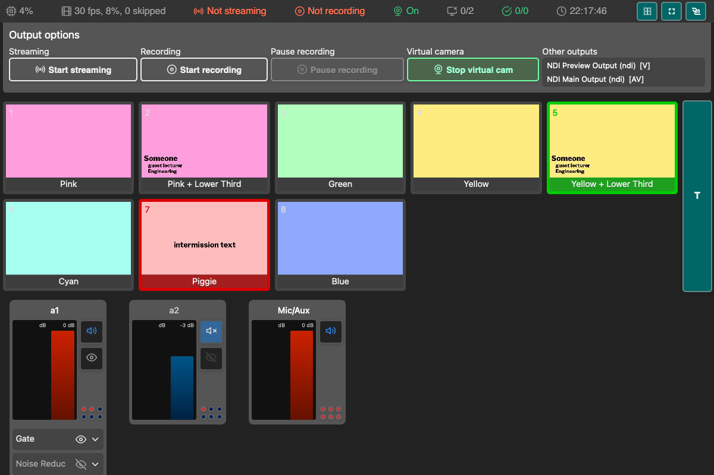

# Web remote for OBS
Web remote UI for controlling [OBS Studio](https://obsproject.com/) through the obs-websocket server built into OBS.

[Português (Brasil)](README.pt-BR.md)

**[→ Live demo](https://dvangennip.github.io/web_remote_for_OBS/)** — you can look at the interface there, but an `https` page cannot open a `ws://` connection to OBS on your machine. To actually control OBS, serve the folder locally as described below.

## Screenshot

## Requirements
- OBS Studio 28 or newer. OBS 28 was the first release to ship obs-websocket 5, so the WebSocket server is already built in; there is no plugin to install.
- Tested with OBS Studio 33.0.1 and obs-websocket 5.7.6, rpcVersion 1.
- The WebSocket server enabled in OBS under **Tools → WebSocket Server Settings**. It is enabled by default on port `4455`; set a password there.
- A browser that supports ES modules (any current browser).

## How to use
1. Download or check out this repository.
2. Serve the repo root folder (where `index.html` is located) over HTTP.
    - For example: `python3 -m http.server 8000`
    - Then open [`http://localhost:8000`](http://localhost:8000)
3. In the connection dialog, enter the host and the password you set in OBS, then connect.
    - The host defaults to `localhost:4455`.
    - It accepts a bare host (`192.168.1.20`), a host and port (`192.168.1.20:4455`), or a full `ws://` or `wss://` URL.
4. Control OBS via the webpage.

> **Serve it over HTTP, not from a file.** ES modules and `ws://` both need a real origin, so opening `index.html` directly from disk (`file://`) will not work. An `https`-hosted copy, such as GitHub Pages, cannot open `ws://` to a local OBS either: browsers block that mixed content. If you must host the page over `https`, the WebSocket has to be fronted with TLS too (`wss://`).

## Features
- Enable/disable Studio Mode (hotkey: `S`)
- Switch between scenes
    - Transition hotkey: `T` (only when in Studio Mode)
    - Left click to switch to scene or (when in Studio Mode) set Preview scene
    - Use `0-9` to set numbered scene (only available for the first ten scenes)
- Control audio sources
    - Mute/unmute
    - Show/hide
    - Volume
    - Live per-source volume meters, fed by the `InputVolumeMeters` event from obs-websocket 5
    - Filter settings (not all filters are supported)
- Change scene item properties
    - Position
    - Scale
    - Rotation
    - Alignment
    - Bounding box
    - Crop
- Enable/disable sources
- Change source properties
    - Text
    - Media
- Change source filter properties
    - Color correction
- Take screenshot of current program
- Start/stop recording, streaming, and replay buffer
- Start/stop virtual camera
- Show statistics
- Hotkeys
    - Refresh (`R`)
    - Save Replay buffer (`P`)
- Add sources to scenes

## Notes and known issues
- An `https`-served copy cannot connect to a plain `ws://` server on your machine; run the app from a local `http://` server instead (see [How to use](#how-to-use)).
- Currently not optimised for use on mobile devices.
- Any scenes with `hidden` or `subscene` in their name are ignored and not shown in the scene list.
- Volume meters only update for inputs that are actively producing audio; that is what obs-websocket reports.
- For more, see [Issues](https://github.com/dvangennip/web_remote_for_OBS/issues)

## Adding text source editing
To add text source editing:
1. Make sure a new "inputs" tab is added. See the "Getting inputs and scenes" below for more details.
2. Add an `input_edit_list` element to the "Inputs" tab: `<ul id="input_edit_list" class="source-list">`
3. Add an `input_select_list` element to the "Inputs" tab: `<ul id="input_select_list" class="source-list">`
4. Add `SourceText.js` to `index.html` (only if text editing is needed)
5. Add Input class to instantiate the input list and set up connections
6. Add creation of SourceText instance to `get_inputs` in `base.js` (only if text editing is needed)

Note that this is a work in progress. The input list will show all inputs, including audio inputs, which cannot be edited as text sources.

## License
- [Unlicense](https://unlicense.org/): This is free and unencumbered software released into the public domain.
- [obs-websocket-js](https://github.com/obs-websocket-community-projects/obs-websocket-js) 5.0.8 is vendored at `vendor/obs-ws.global.js` and loaded as a plain script, so the app needs no build step and nothing to install to run. `vendor/README.md` records where the bundle came from and its SHA-256; the MIT license is in `vendor/obs-websocket-js.LICENSE`.
- Icons: [Feather](https://feathericons.com/)
