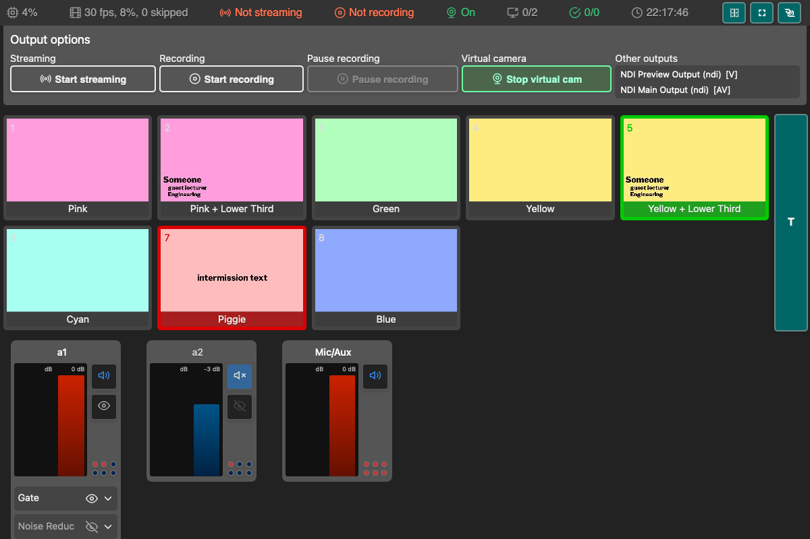

# Web remote for OBS
Interface web para controlar o [OBS Studio](https://obsproject.com/) pelo servidor obs-websocket que já vem embutido no OBS.

[English](README.md)

**[→ Demo online](https://dvangennip.github.io/web_remote_for_OBS/)** — dá para ver a interface por lá, mas uma página em `https` não consegue abrir uma conexão `ws://` com o OBS da sua máquina. Para controlar o OBS de verdade, sirva a pasta localmente como explicado abaixo.

## Captura de tela

## Requisitos
- OBS Studio 28 ou mais novo. O OBS 28 foi a primeira versão a trazer o obs-websocket 5, então o servidor WebSocket já vem embutido; não há plugin para instalar.
- Testado com OBS Studio 33.0.1 e obs-websocket 5.7.6, rpcVersion 1.
- Servidor WebSocket ativado no OBS em **Ferramentas → Configurações do servidor WebSocket**. Ele já vem ativado na porta `4455`; defina uma senha ali.
- Um navegador com suporte a módulos ES (qualquer navegador atual).

## Como usar
1. Baixe ou clone este repositório.
2. Sirva a raiz do repositório (onde fica o `index.html`) por HTTP.
    - Por exemplo: `python3 -m http.server 8000`
    - Depois abra [`http://localhost:8000`](http://localhost:8000)
3. Na caixa de conexão, informe o host e a senha que você definiu no OBS e conecte.
    - O host vem preenchido com `localhost:4455`.
    - Aceita só o host (`192.168.1.20`), host e porta (`192.168.1.20:4455`) ou uma URL completa `ws://` ou `wss://`.
4. Controle o OBS pela página.

> **Sirva por HTTP, não abra o arquivo direto.** Módulos ES e `ws://` precisam de uma origem real, então abrir o `index.html` direto do disco (`file://`) não funciona. Uma cópia hospedada em `https`, como no GitHub Pages, também não consegue abrir `ws://` para o OBS local: o navegador bloqueia esse conteúdo misto. Se você precisar hospedar a página em `https`, o WebSocket também tem que estar atrás de TLS (`wss://`).

## Recursos
- Ativar/desativar o Modo Estúdio (atalho: `S`)
- Alternar entre cenas
    - Atalho de transição: `T` (só no Modo Estúdio)
    - Clique com o botão esquerdo para trocar de cena ou, no Modo Estúdio, definir a cena de pré-visualização
    - Use `0-9` para escolher a cena numerada (só vale para as dez primeiras cenas)
- Controlar fontes de áudio
    - Mudo/desmudo
    - Mostrar/ocultar
    - Volume
    - Medidores de volume ao vivo por fonte, alimentados pelo evento `InputVolumeMeters` do obs-websocket 5
    - Configurações de filtro (não são todos os filtros que funcionam)
- Alterar propriedades de itens de cena
    - Posição
    - Escala
    - Rotação
    - Alinhamento
    - Caixa delimitadora
    - Corte
- Ativar/desativar fontes
- Alterar propriedades de fontes
    - Texto
    - Mídia
- Alterar propriedades de filtros de fonte
    - Correção de cor
- Tirar captura da cena atual do programa
- Iniciar/parar gravação, transmissão e buffer de replay
- Iniciar/parar a câmera virtual
- Ver estatísticas
- Atalhos
    - Atualizar (`R`)
    - Salvar buffer de replay (`P`)
- Adicionar fontes às cenas

## Observações e problemas conhecidos
- Uma cópia servida por `https` não conecta em um servidor `ws://` simples na sua máquina; use um servidor `http://` local (veja [Como usar](#como-usar)).
- A interface ainda não é otimizada para celular.
- Cenas com `hidden` ou `subscene` no nome são ignoradas e não aparecem na lista.
- Os medidores de volume só se atualizam para fontes que estão produzindo áudio de fato; é o que o obs-websocket informa.
- Para mais detalhes, veja as [issues](https://github.com/dvangennip/web_remote_for_OBS/issues)

## Como adicionar edição de fonte de texto
Para adicionar edição de fonte de texto:
1. Garanta que exista uma aba "inputs" nova. Veja "Obtendo entradas e cenas" abaixo para os detalhes.
2. Adicione um elemento `input_edit_list` à aba "Inputs": `<ul id="input_edit_list" class="source-list">`
3. Adicione um elemento `input_select_list` à aba "Inputs": `<ul id="input_select_list" class="source-list">`
4. Inclua `SourceText.js` no `index.html` (só se a edição de texto for necessária)
5. Adicione a classe Input para instanciar a lista de entradas e montar as conexões
6. Adicione a criação da instância de SourceText em `get_inputs`, no `base.js` (só se a edição de texto for necessária)

Isso ainda está em desenvolvimento. A lista de entradas mostra todas as entradas, inclusive as de áudio, que não podem ser editadas como fonte de texto.

## Licença
- [Unlicense](https://unlicense.org/): software livre e sem restrições, liberado para o domínio público.
- O [obs-websocket-js](https://github.com/obs-websocket-community-projects/obs-websocket-js) 5.0.8 está vendorizado em `vendor/obs-ws.global.js` e é carregado como script comum, então o app não precisa de build nem de instalação para rodar. O `vendor/README.md` registra a origem do bundle e o SHA-256; a licença MIT está em `vendor/obs-websocket-js.LICENSE`.
- Ícones: [Feather](https://feathericons.com/)
